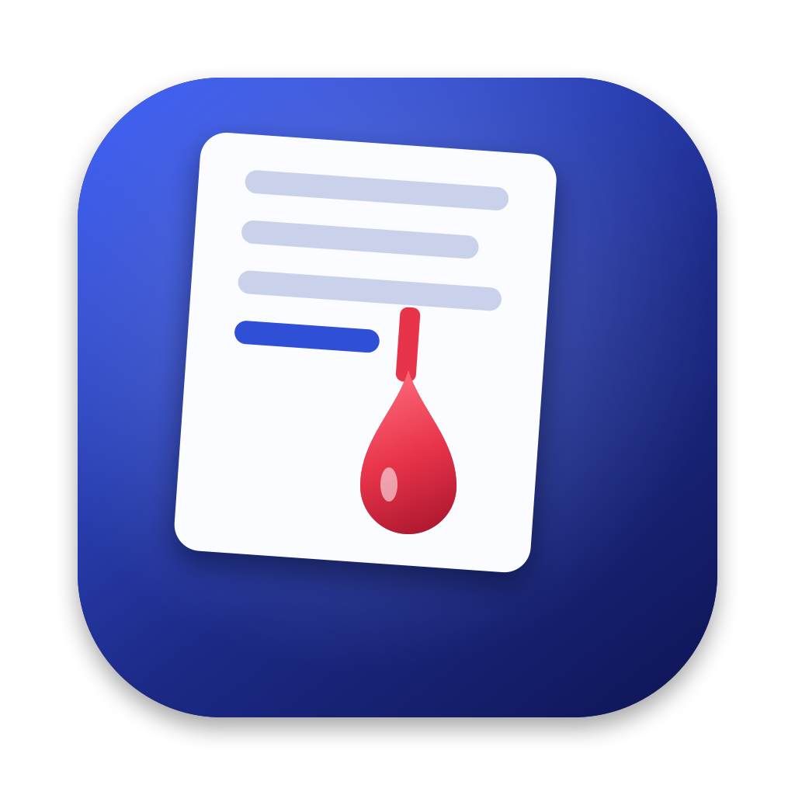

<p align="center">
  
</p>
<p align="center">
  <picture>
    <source media="(prefers-color-scheme: dark)" srcset="assets/logo-dark.svg">
    
  </picture>
</p>
<p align="center"><b>Types your text into any app, one keystroke at a time.</b><br>
Exactly as written: every space, tab and blank line.</p>

## Install (macOS 14+)

```bash
curl -fsSL https://raw.githubusercontent.com/learningnihongo934-byte/dripwriter/main/install.sh | bash
```

This puts **DripWriter.app** in Applications and adds a `dripwriter` terminal command. The first time you press Start, macOS asks you to allow DripWriter under **System Settings → Privacy & Security → Accessibility**.

No Mac? Use the [web version](https://learningnihongo934-byte.github.io/dripwriter/app/), which types onto its own page.

## Use it

| | |
|---|---|
| `⌃⌥⌘V` | Type the clipboard wherever your cursor is |
| `⌃⌥⌘D` | Start / pause the text in the DripWriter window |
| `⌃⌥⌘M` | Mash mode: any keys you press type your text |
| `⌃⌥⌘↑` `⌃⌥⌘↓` | Faster / slower, even mid-run |
| `esc` or `⌃⌥⌘.` | Stop |

## Features

- **Types anywhere.** Notes, Google Docs, Word, Slack, Discord, VS Code, browsers, terminals.
- **Types in the background.** Pick an app and it keeps typing there while you watch a video, switch apps or change Spaces.
- **Mash mode.** Smash any keys, anywhere, and your text comes out instead, exactly as written. `⌃⌥⌘M`.
- **Start at a time.** Schedule it for 3:00 PM; your Mac stays awake until it's done.
- **Done by a time.** Set an end time and it paces itself to land on it, speeding up or slowing down as it goes.
- **Repeat mode.** Retype the same text 2 to 9,999 times, or forever. Put a new line, a blank line, a space or nothing between rounds, and add a pause if you like. With "Finish in" or "Done by", forever means it keeps going until that time. It works in Mash mode too.
- **Breaks.** Up to three break windows where nothing gets typed; it picks up where it stopped.
- **Pace your way.** 12 wpm up to 400 keys a second, or tell it to **finish in** 5 minutes and it works out the speed.
- **Five rhythms.** Human (pauses after sentences), Steady, Nervous, Burst and Drip.
- **Realistic typos.** Hits a neighboring key, pauses, backspaces, fixes it.
- **Floating progress panel** with pause and stop, on every Space.
- **Safe.** Esc stops instantly; switching apps pauses it and coming back resumes.
- **Chat-app friendly.** New lines as Shift+Return so Slack and Discord don't send early.
- **Code-editor friendly.** Skip indentation so auto-indenting editors don't double it.
- **Clean-up.** Straighten smart quotes, tabs to spaces, trim trailing spaces.
- **Library.** Saved snippets, recent history, drag-and-drop text files, lifetime stats.
- **Try it here.** A preview run inside the app before you point it at anything.
- **Menu bar** progress, snippet menu, open at login, key sounds and a margin bell.

## Terminal command

```bash
dripwriter "hello world"                 # type text into the front app
dripwriter -f essay.txt -w 90 -T 2       # a file at 90 wpm with 2% typos
pbpaste | dripwriter -t 5m               # the clipboard, finishing in 5 minutes
dripwriter -r burst --shift-enter -f msg.txt
dripwriter -f essay.txt -a Notes         # type into Notes in the background
dripwriter -f essay.txt --at 9am -u 5pm -b 12:00-13:00   # 9 to 5 with a lunch break
dripwriter -R 10 --sep blank "Line"      # type it 10 times, blank line between
dripwriter -R 0 -t 30m -f chant.txt      # keep retyping it for 30 minutes
dripwriter --dry -f essay.txt            # how long would it take?
dripwriter --help
```

The terminal app you run it from needs Accessibility access too.

## Build from source

```bash
mac/build.sh --install     # universal app → /Applications, plus the dripwriter command
web/build.sh               # web version → docs/app/
```

The macOS app is one Swift file, [`mac/DripWriter.swift`](mac/DripWriter.swift). The icon is drawn in code by [`mac/tools/make-icon.swift`](mac/tools/make-icon.swift).

## Uninstall

```bash
curl -fsSL https://raw.githubusercontent.com/learningnihongo934-byte/dripwriter/main/install.sh | bash -s -- --uninstall
```

---

Made by **Virat Reddy Kaukuntla** ([@learningnihongo934-byte](https://github.com/learningnihongo934-byte)) · [rennko.tech](https://rennko.tech)
